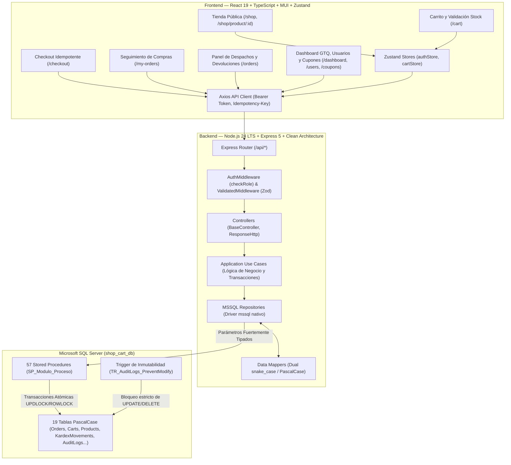
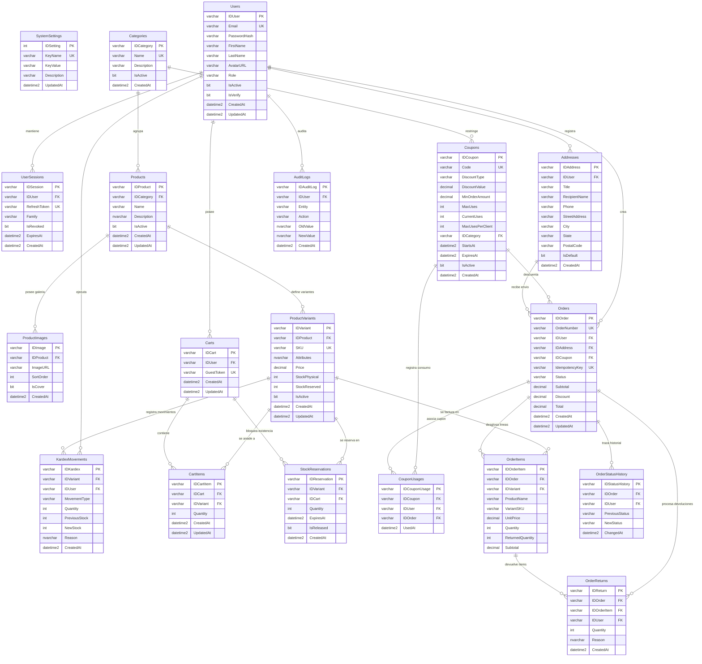

# shopCART — Plataforma de Comercio Electrónico y Gestión Comercial

Bienvenido a **shopCART**, una solución integral de comercio electrónico y gestión logística de alto rendimiento construida con arquitectura limpia (**Clean Architecture / DDD**), motor relacional **Microsoft SQL Server 2019+ (Transact-SQL)** con acceso a datos **100% exclusivo mediante Stored Procedures (`SP_Modulo_Proceso`)** y triggers de inmutabilidad, y una interfaz de usuario en **React 19 + TypeScript + Vite + Material UI (MUI) + Zustand** inspirada en el sistema de diseño comercial **Ecom Marketplace**.

---

## Índice

1. [Requisitos del Entorno (Backend y Frontend)](#1-requisitos-del-entorno)
2. [Base de Datos Microsoft SQL Server](#2-base-de-datos-microsoft-sql-server)
   - [Ubicación de Scripts SQL](#ubicación-de-scripts-sql)
   - [Scripts de Despliegue de Esquema, Triggers y Stored Procedures](#scripts-de-despliegue)
   - [Ejecución de Seeds y Cuentas de Prueba de los 3 Roles](#ejecución-de-seeds-y-cuentas-de-prueba-de-los-3-roles)
3. [Arquitectura del Sistema y Justificación Técnica](#3-arquitectura-del-sistema-y-justificación-técnica)
   - [Justificación de Arquitectura y Decisiones de Diseño](#justificación-de-arquitectura-y-decisiones-de-diseño)
   - [Arquitectura en Backend (Clean Architecture / Hexagonal)](#arquitectura-en-backend)
   - [Arquitectura en Frontend (Modular en Capas)](#arquitectura-en-frontend)
   - [Diagrama de Arquitectura y Flujo de Datos](#diagrama-de-arquitectura)
4. [Diagramas de Dominio y Procesos de Negocio](#4-diagramas-de-dominio-y-procesos-de-negocio)
   - [Diagrama Entidad-Relación (DER) — 19 Tablas PascalCase](#diagrama-entidad-relación-der)
   - [Diagrama de Estados del Ciclo de Vida del Pedido y Devoluciones](#diagrama-de-estados-del-ciclo-de-vida-del-pedido)
5. [Tecnologías y Librerías Utilizadas](#5-tecnologías-y-librerías-utilizadas)
6. [Catálogo Completo de Endpoints de la API REST](#6-catálogo-completo-de-endpoints-de-la-api-rest)
   - [Módulo de Autenticación (`/api/auth`)](#módulo-de-autenticación-apiauth)
   - [Módulo de Usuarios (`/api/users`)](#módulo-de-usuarios-apiusers)
   - [Módulo de Catálogo, Productos, Variantes y Categorías (`/api/products`)](#módulo-de-productos-variantes-y-categorías-apiproducts)
   - [Módulo de Carrito de Compras (`/api/cart`)](#módulo-de-carrito-de-compras-apicart)
   - [Módulo de Cupones y Promociones (`/api/coupons`)](#módulo-de-cupones-y-promociones-apicoupons)
   - [Módulo de Direcciones, Checkout y Pedidos (`/api/orders`)](#módulo-de-direcciones-checkout-y-pedidos-apiorders)
   - [Módulo de Reportes, Métricas GTQ y Bitácora de Auditoría (`/api/reports`)](#módulo-de-reportes-métricas-gtq-y-bitácora-de-auditoría-apireports)
7. [Inventario de los 57 Stored Procedures y Triggers](#7-inventario-de-los-57-stored-procedures-y-triggers)
8. [Instrucciones de Instalación y Ejecución Local](#8-instrucciones-de-instalación-y-ejecución-local)

---

## 1. Requisitos del Entorno

### Requisitos Globales
- **Node.js**: `>= 20.x LTS` (Recomendado Node 22 o 24 LTS).
- **Gestor de paquetes**: `npm` `>= 10.x`.
- **Motor de Base de Datos**: **Microsoft SQL Server 2019+** (Instancia Local, Contenedor Docker o Azure SQL Database) en el puerto `1433`.

### Variables de Entorno del Backend (`backend/.env`)
Copia `backend/.env.example` a `backend/.env`:

```env
PORT=4000
FRONTEND_URL=http://localhost:8001

# Microsoft SQL Server (Transact-SQL)
DB_SERVER=localhost
DB_PORT=1433
DB_NAME=shop_cart_db
DB_USER=sa
DB_PASSWORD=TuPasswordSeguro123%
DB_ENCRYPT=true
DB_TRUST_SERVER_CERTIFICATE=true

# Seguridad Criptográfica JWT (jose)
JWT_SECRET=super_secret_jwt_key_shopcart_production_2026_xyz
JWT_ISS=shopcart-api
JWT_AUD=shopcart-client
JWT_ACCESS_TTL=15m
JWT_REFRESH_TTL=7d

# Cuentas Iniciales para Seeds
SEED_ADMIN_EMAIL=kevin01306@gmail.com
SEED_ADMIN_PASSWORD=12345678
SEED_OPERATOR_EMAIL=operador@shopcart.com
SEED_OPERATOR_PASSWORD=12345678
SEED_CLIENT_EMAIL=cliente@shopcart.com
SEED_CLIENT_PASSWORD=12345678
```

### Variables de Entorno del Frontend (`frontend/.env`)
Copia `frontend/.env.example` a `frontend/.env`:
```env
VITE_API_URL=http://localhost:4000/api
```

---

## 2. Base de Datos Microsoft SQL Server

> [!IMPORTANT]
> **REQUISITO PREVIO INDISPENSABLE**:
> Antes de ejecutar cualquier script (`db:init`, `db:sp`, `db:seed`), la base de datos `shop_cart_db` **DEBE estar previamente creada** en tu servidor Microsoft SQL Server:
> ```sql
> CREATE DATABASE shop_cart_db;
> ```
> Si la base de datos no existe en SQL Server, el conector rechazará la conexión con el error `Login failed for user 'sa' (Reason: Failed to open the explicitly specified database 'shop_cart_db')`.

### Ubicación de Scripts SQL
Todos los scripts de base de datos se encuentran versionados en `backend/src/shared/db/scripts/`:
- **Esquema de Tablas (`db.sql`)**: 19 tablas relacionales en convención `PascalCase` con tipos estrictos (`DECIMAL(12,2)` para moneda GTQ e `INT` para existencias, prohibiendo estrictamente `FLOAT` o `REAL`).
- **Triggers de Integridad (`TR/`)**:
  - `TR_AuditLogs_PreventModify.sql`: Impide operaciones de `UPDATE` o `DELETE` sobre la tabla `AuditLogs`, garantizando la inmutabilidad de la bitácora requerida por **RF-09**.
- **Procedimientos Almacenados (`SP/`)**:
  - `SP_Auth_Users.sql`: 14 SPs para sesiones, usuarios y autenticación.
  - `SP_Products_Categories.sql`: 15 SPs para categorías, productos, galería en `ProductImages`, variantes y Kardex.
  - `SP_Carts.sql`: 7 SPs para carritos con control de existencias en tiempo real.
  - `SP_Coupons.sql`: 6 SPs para CRUD y motor de validación/aplicación de cupones con límites globales y por cliente.
  - `SP_Orders_Addresses.sql`: 10 SPs para direcciones, reserva temporal de 15m, checkout atómico idempotente, ciclo de vida de pedidos y devoluciones.
  - `SP_Reports_AuditLogs.sql`: 2 SPs para métricas financieras en GTQ con exclusión de cancelados y bitácora paginada.
  - `SP_Modulo_Proceso.sql`: 3 SPs de reservas concurrentes, liberación automática y parámetros de sistema (`SystemSettings`).

### Scripts de Despliegue

```bash
cd backend

# 1. Crea las 19 tablas en PascalCase y registra el Trigger de Inmutabilidad
npm run db:init

# 2. Despliega (o actualiza con CREATE OR ALTER) los 57 Stored Procedures
npm run db:sp

# 3. Despliega el trigger de inmutabilidad de forma individual (si es requerido)
npm run db:tr
```

### Ejecución de Seeds y Cuentas de Prueba de los 3 Roles

Para inicializar las tablas de configuración, poblar el catálogo con imágenes, variantes, Kardex, cupones promocionales, direcciones y crear las credenciales oficiales de los **3 roles del sistema (RF-01)**, ejecuta un solo comando:

```bash
cd backend
npm run db:seed
```

#### Credenciales Demo Listas para Prueba:

| Rol | Correo Electrónico | Contraseña | Alcance de Acceso y Funcionalidades |
| :--- | :--- | :--- | :--- |
| **Administrador** | `kevin01306@gmail.com` | `12345678` | **Acceso Total**: Dashboard Comercial con gráficas GTQ (`/dashboard`), Bitácora de Auditoría Inmutable (`/audit-logs`), Directorio de Usuarios (`/users`), Panel de Cupones (`/coupons`), Gestión de Categorías, Catálogo/Productos/Kardex (`/products`), Gestión y Despacho de Pedidos (`/orders`) y Tienda Pública. |
| **Operador** | `operador@shopcart.com` | `12345678` | **Gestión Logística y Operativa**: Listado y preparación de pedidos, despacho, entrega, cancelaciones previas al despacho, procesamiento de devoluciones autorizadas con reintegro automático al Kardex (`/orders`), y ajustes manuales de existencias con motivo obligatorio en inventario (`/products`). |
| **Cliente** | `cliente@shopcart.com` | `12345678` | **Experiencia de Tienda**: Navegación de catálogo con filtros de servidor y disponibilidad, carrito con validación de stock, aplicación de cupones con descuento en tiempo real, gestión de direcciones de entrega, checkout con reserva garantizada de 15 minutos, y seguimiento de compras en Mis Pedidos (`/my-orders`). |

#### Cupones Promocionales Sembrados para Pruebas:
- **`BIENVENIDA10`**: 10% de descuento en el total del pedido (compra mínima de Q500.00, máx. 2 usos por cliente).
- **`QUETZAL150`**: Monto fijo de Q150.00 de descuento (compra mínima de Q1,000.00, máx. 1 uso por cliente).
- **`TECH15`**: 15% de descuento exclusivo para productos de la categoría *Computers & Laptop* (compra mínima de Q1,500.00).

---

## 3. Arquitectura del Sistema y Justificación Técnica

### Justificación de Arquitectura y Decisiones de Diseño

1. **Uso Exclusivo de Stored Procedures (`mssql`) — Prohibición de ORM**:
   - Para cumplir rigurosamente con los requerimientos empresariales de consistencia transaccional y prevención de sobreventa (**RF-06**), todo acceso a datos se centraliza en **57 Stored Procedures parametrizados**.
   - Permite aplicar bloqueos de concurrencia explícitos a nivel de fila (`WITH (UPDLOCK, ROWLOCK)`) durante el checkout y reservas de inventario, asegurando aislamiento `SERIALIZABLE` en bloques `BEGIN TRANSACTION / COMMIT`.
   - Evita problemas comunes de ORMs como consultas `N+1`, generación ineficiente de SQL y sobrecarga de mapeo en memoria.
2. **Reserva Temporal de Stock por 15 Minutos y Prevención de Sobreventa**:
   - Al ingresar al checkout, el procedimiento `SP_Checkout_IniciarReservaCarrito` incrementa el campo `StockReserved` en `ProductVariants` e inserta registros en `StockReservations` con vigencia exacta de 15 minutos (`DATEADD(MINUTE, 15, GETDATE())`).
   - La restricción de tabla `CK_Stock_Limit CHECK (StockReserved <= StockPhysical)` garantiza a nivel de motor que la existencia reservada nunca supere la física.
   - Tanto el checkout como las consultas liberan periódica y automáticamente reservas vencidas (`ExpiresAt < GETDATE() AND IsReleased = 0`).
3. **Idempotencia de Checkout (`IdempotencyKey`)**:
   - Cada intento de pago envía un token criptográfico único (`IdempotencyKey`). Si el usuario hace doble clic o reintenta por inestabilidad de red, `SP_Pedidos_CrearCheckoutAtomico` detecta la clave existente vía `WITH (UPDLOCK, HOLDLOCK)` y retorna el pedido original sin generar cobros duplicados ni rebajar dos veces el inventario.
4. **Seguridad y Roles Fijos**:
   - Criptografía de contraseñas con **Argon2id** (estándar OWASP para mitigación de ataques por GPU/ASIC).
   - Autenticación mediante **JWT (`jose`)** con rotación de `RefreshToken` en `UserSessions`.
   - Control de acceso por roles fijos (`Administrador`, `Operador`, `Cliente`) en middleware y componentes `RouteProtector`.
5. **Tipos Numéricos y Moneda Oficial Quetzales (`GTQ`)**:
   - Todo campo monetario o de existencias utiliza `DECIMAL(12, 2)` o `INT`. Está estrictamente prohibido el uso de coma flotante (`FLOAT` o `REAL`) para prevenir desajustes de centavos en liquidaciones y reportes.

### Arquitectura en Backend
Estructurado en **Clean Architecture (Hexagonal)**:
- **`domain/`**: Entidades puras e interfaces de repositorios desacopladas de frameworks.
- **`application/`**: Casos de uso (`UseCases`) que coordinan transacciones, validaciones y auditoría.
- **`infrastructure/`**: Implementaciones con driver nativo `mssql`, mapeadores (`Mappers`) de filas de base de datos a entidades de dominio y adaptadores de seguridad.
- **`presentation/`**: Controladores Express, middlewares (`AuthMiddleware`, `ValidatedMiddleware` con **Zod**) y respuestas unificadas (`ResponseHttp`).

### Arquitectura en Frontend
Desarrollado en **React 19 + TypeScript + Vite + Material UI (MUI)**:
- **`src/core/`**: Temas globales (paleta Ecom Marketplace `#425A8B`, `#FD9636`, `#D5DFE4`), clientes Axios con interceptor de credenciales y stores globales con **Zustand** (`authStore`, `cartStore`).
- **`src/modules/`**: Módulos independientes divididos en `domain/` (DTOs y schemas Zod), `infrastructure/` (servicios API) y `presentation/` (páginas, diálogos y componentes modulares con restricción de tamaño `< 150` líneas).

### Diagrama de Arquitectura



---

## 4. Diagramas de Dominio y Procesos de Negocio

### Diagrama Entidad-Relación (DER)



### Diagrama de Estados del Ciclo de Vida del Pedido

El sistema implementa una máquina de estados controlada (**RF-07**), asegurando consistencia física y financiera en cada transición:

```mermaid
stateDiagram-v2
    [*] --> CREADO: Inicio de checkout
    CREADO --> PAGADO: Checkout completado (IdempotencyKey)
    
    state "Proceso Operativo (Operador / Administrador)" as Operacion {
        PAGADO --> PREPARACION: Operador toma pedido para embalaje
        PREPARACION --> DESPACHADO: Pedido sale a ruta de entrega
        DESPACHADO --> ENTREGADO: Confirmación de recepción final
    }

    state "Reglas de Cancelación y Reintegro" as Cancelaciones {
        CREADO --> CANCELADO: Cancelación de cliente o expiración
        PAGADO --> CANCELADO: Cancelación antes de despacho (Reintegro físico ENTRADA a Kardex)
        PREPARACION --> CANCELADO: Cancelación antes de despacho (Reintegro físico ENTRADA a Kardex)
    }

    state "Reglas de Devolución Autorizada" as Devoluciones {
        DESPACHADO --> DEVUELTO: Devolución total de ítems (Reintegro DEVOLUCION a Kardex)
        ENTREGADO --> DEVUELTO: Devolución total de ítems (Reintegro DEVOLUCION a Kardex)
        ENTREGADO --> ENTREGADO: Devolución parcial (Reintegro DEVOLUCION a Kardex)
    }

    CANCELADO --> [*]
    DEVUELTO --> [*]
```

- **Regla de Cancelación**: Permitida **exclusivamente antes del despacho** (`CREADO`, `PAGADO`, `PREPARACION`). Si el pedido ya está en estado `DESPACHADO` o `ENTREGADO`, el procedimiento `SP_Pedidos_Cancelar` bloquea la operación y exige un proceso formal de devolución. Al cancelarse, se reingresan automáticamente las existencias a `ProductVariants.StockPhysical` con un movimiento `ENTRADA` en `KardexMovements`.
- **Regla de Devolución**: Permitida en estados `DESPACHADO` o `ENTREGADO`. `SP_Pedidos_ProcesarDevolucion` valida que la cantidad devuelta no supere la comprada (`ReturnedQuantity + @p_qty <= Quantity`), repone el stock físico e inserta un movimiento `DEVOLUCION` en el Kardex. Si todas las líneas de un pedido son devueltas en su totalidad, el pedido cambia automáticamente a estado `DEVUELTO`.

---

## 5. Tecnologías y Librerías Utilizadas

| Componente | Tecnología | Versión | Justificación Técnica |
| :--- | :--- | :--- | :--- |
| **Runtime Backend** | Node.js (ESM) | `>= 24 LTS` | Soporte nativo de módulos ECMAScript (`"type": "module"`), Web Streams y alto rendimiento I/O asíncrono. |
| **Lenguaje Backend** | TypeScript | `^5.9.3` | Tipado estático estricto (`strict: true`), mitigación de errores en tiempo de diseño y generación de contratos limpios. |
| **Framework HTTP** | Express | `^5.2.1` | Ruteo declarativo ligero, arquitectura en middlewares desacoplados y control nativo de errores asíncronos. |
| **Motor de Base de Datos** | Microsoft SQL Server | `2019+` | Motor relacional enterprise con soporte transaccional `ACID`, tipos JSON nativos y bloqueos `UPDLOCK, ROWLOCK`. |
| **Driver de Base de Datos** | `mssql` (Tedious) | `^11.0.2` | Conexión nativa con pooling administrado para invocación de Stored Procedures sin sobrecarga de ORM. |
| **Seguridad de Passwords** | `argon2` | `^0.44.0` | Algoritmo ganador de la Password Hashing Competition (PHC), con costo de memoria configurable anti-fuerza bruta. |
| **Seguridad de Tokens** | `jose` | `^6.1.3` | Implementación moderna, segura y sin dependencias de OpenSSL para firma y verificación de JWTs (`access`, `refresh`). |
| **Validación de Schemas** | `zod` | `^4.3.6` | Inferencia estática de tipos TypeScript a partir de esquemas de validación en tiempo de ejecución. |
| **Framework Frontend** | React | `^19.2.8` | Biblioteca estándar con renderizado concurrente, hooks de estado y rendimiento optimizado de componentes. |
| **Empaquetador Frontend** | Vite | `^8.3.0` | Hot Module Replacement (HMR) ultrarrápido y compilación de producción optimizada mediante Rollup. |
| **Librería de Componentes** | Material UI (MUI) | `^9.4.0` | Sistema de componentes accesibles y temables adaptados a la estética comercial Ecom Marketplace. |
| **Gestión de Estado** | Zustand | `^5.0.15` | Estado global reactivo ligero y persistente en `localStorage` para sesión y sincronización del carrito. |
| **Formularios Frontend** | React Hook Form | `^7.88.0` | Manejo de formularios de alto rendimiento sin re-renderizados innecesarios, acoplado con resolvers Zod. |

---

## 6. Catálogo Completo de Endpoints de la API REST

### Módulo de Autenticación (`/api/auth`)
| Método | Ruta | Acceso | Descripción |
| :--- | :--- | :--- | :--- |
| `POST` | `/api/auth/register` | Público | Registro inmediato de cliente (`Cliente`) con hash Argon2 y emisión automática de tokens sin OTP bloqueante. |
| `POST` | `/api/auth/login` | Público | Autenticación con email y contraseña; emite `accessToken` (15m) y cookie `refreshToken` (7d). |
| `POST` | `/api/auth/refresh` | Público (Cookie) | Rotación criptográfica de sesión y emisión de nuevo token de acceso. |
| `POST` | `/api/auth/logout` | Autenticado | Revoca la sesión en `UserSessions` y limpia la cookie de autenticación. |
| `GET` | `/api/auth/me` | Autenticado | Obtiene los datos del usuario autenticado y su rol de sistema. |

### Módulo de Usuarios (`/api/users`)
| Método | Ruta | Acceso | Descripción |
| :--- | :--- | :--- | :--- |
| `GET` | `/api/users/roles` | `Administrador` | Lista los 3 roles admitidos (`Administrador`, `Operador`, `Cliente`). |
| `PATCH` | `/api/users/me/password` | Autenticado | Cambio de contraseña del propio usuario autenticado. |
| `GET` | `/api/users` | `Administrador` | Directorio paginado de usuarios con búsqueda por nombre, apellido, correo o rol. |
| `POST` | `/api/users` | `Administrador` | Creación de usuario administrativo con contraseña autogenerada o manual y envío de bienvenida. |
| `PUT` | `/api/users/:id` | `Administrador` | Actualización de perfil y rol de usuario. |
| `PATCH` | `/api/users/:id/activate` | `Administrador` | Reactivación lógica de usuario (`IsActive = 1`). |
| `PATCH` | `/api/users/:id/disable` | `Administrador` | Desactivación lógica de usuario (`IsActive = 0`). |
| `DELETE` | `/api/users/:id` | `Administrador` | Borrado lógico de usuario. |

### Módulo de Catálogo, Productos, Variantes y Categorías (`/api/products`)
| Método | Ruta | Acceso | Descripción |
| :--- | :--- | :--- | :--- |
| `GET` | `/api/products/catalog` | Público | Catálogo con filtros del lado del servidor (`q`, `categoryId`, `minPrice`, `maxPrice`, `inStock`, `sortBy`). |
| `GET` | `/api/products/catalog/categories`| Público | Listado de categorías activas con conteo de productos para los filtros laterales. |
| `GET` | `/api/products/catalog/:id` | Público | Detalle público de producto con todas sus imágenes en `ProductImages` y variantes activas. |
| `GET` | `/api/products/categories` | `Admin`, `Operador` | Listado administrativo de categorías activas e inactivas. |
| `POST` | `/api/products/categories` | `Admin`, `Operador` | Creación de categoría única con validación de duplicados. |
| `PUT` | `/api/products/categories/:id` | `Admin`, `Operador` | Modificación de nombre, descripción o estado activo de categoría. |
| `GET` | `/api/products` | `Admin`, `Operador` | Listado administrativo con variantes, stock físico, reservado y disponible. |
| `GET` | `/api/products/:id` | `Admin`, `Operador` | Detalle administrativo de producto y desglose de variantes. |
| `POST` | `/api/products` | `Admin`, `Operador` | Crea producto, sincroniza múltiples imágenes en `ProductImages` y crea variantes con Kardex inicial. |
| `PUT` | `/api/products/:id` | `Admin`, `Operador` | Actualiza producto, reemplaza galería de imágenes y sincroniza variantes. |
| `PATCH` | `/api/products/:id/status` | `Admin`, `Operador` | Borrado lógico o reactivación de producto (`IsActive = 1 / 0`). |
| `POST` | `/api/products/:id/variants` | `Admin`, `Operador` | Añade una variante a un producto existente con movimiento `ENTRADA` en Kardex. |
| `PUT` | `/api/products/:id/variants/:variantId` | `Admin`, `Operador` | Modifica SKU, precio, atributos JSON o estado de una variante con auditoría. |
| `PATCH` | `/api/products/:id/variants/:variantId/stock` | `Admin`, `Operador` | Ajuste transaccional manual de existencias (`ENTRADA`, `SALIDA`, `AJUSTE`) con motivo obligatorio. |
| `GET` | `/api/products/kardex` | `Admin`, `Operador` | Consulta paginada del historial de movimientos de inventario en `KardexMovements`. |

### Módulo de Carrito de Compras (`/api/cart`)
| Método | Ruta | Acceso | Descripción |
| :--- | :--- | :--- | :--- |
| `GET` | `/api/cart` | Público / `x-guest-token` / Bearer | Consulta carrito activo, ítems, existencias disponibles y subtotales en GTQ. |
| `POST` | `/api/cart/items` | Público / `x-guest-token` / Bearer | Añade o incrementa variante validando que la cantidad no supere el stock disponible. |
| `PUT` | `/api/cart/items/:variantId` | Público / `x-guest-token` / Bearer | Modifica la cantidad exacta de una variante (rechaza con 409 si supera existencias). |
| `DELETE` | `/api/cart/items/:variantId` | Público / `x-guest-token` / Bearer | Elimina una variante del carrito. |
| `DELETE` | `/api/cart` | Público / `x-guest-token` / Bearer | Vacía todos los ítems del carrito. |
| `POST` | `/api/cart/sync` | Autenticado | Fusiona los ítems del carrito de invitado al iniciar sesión. |

### Módulo de Cupones y Promociones (`/api/coupons`)
| Método | Ruta | Acceso | Descripción |
| :--- | :--- | :--- | :--- |
| `POST` | `/api/coupons/validate` | Público / Opcional Auth | Valida en tiempo real un cupón contra el carrito, revisando vigencia, límites y monto mínimo. |
| `GET` | `/api/coupons` | `Administrador` | Listado paginado de cupones con conteo de usos actuales y categoría asociada. |
| `POST` | `/api/coupons` | `Administrador` | Crea un cupón promocional (tipo porcentaje o monto fijo en GTQ). |
| `PUT` | `/api/coupons/:id` | `Administrador` | Modifica vigencia, monto mínimo o límites de uso de un cupón. |
| `PATCH` | `/api/coupons/:id/status` | `Administrador` | Activa o desactiva lógicamente un cupón. |

### Módulo de Direcciones, Checkout y Pedidos (`/api/orders`)
| Método | Ruta | Acceso | Descripción |
| :--- | :--- | :--- | :--- |
| `GET` | `/api/orders/addresses` | Autenticado | Lista las direcciones de envío del usuario en sesión ordenadas por predeterminada. |
| `POST` | `/api/orders/addresses` | Autenticado | Registra una nueva dirección de envío con validación de formato. |
| `DELETE` | `/api/orders/addresses/:id` | Autenticado | Elimina una dirección de envío si no tiene pedidos históricos asociados. |
| `POST` | `/api/orders/checkout/reserve` | Autenticado | Aparta temporalmente las unidades del carrito por 15 minutos en `StockReservations`. |
| `POST` | `/api/orders/checkout` | Autenticado | Transacción atómica de checkout con `IdempotencyKey`, consumo de cupón y salida en Kardex. |
| `GET` | `/api/orders/my` | Autenticado (`Cliente`) | Consulta el historial de pedidos propios del cliente en sesión. |
| `GET` | `/api/orders` | `Admin`, `Operador` | Listado administrativo y logístico de pedidos con filtros por estado, cliente y fechas. |
| `GET` | `/api/orders/:id` | Autenticado | Detalle completo de pedido (con validación de pertenencia 403 para `Cliente`). |
| `PATCH` | `/api/orders/:id/status` | `Admin`, `Operador` | Avanza el estado del pedido en la máquina de estados (`PREPARACION`, `DESPACHADO`, `ENTREGADO`). |
| `POST` | `/api/orders/:id/cancel` | Autenticado / Staff | Cancela pedido antes de despacho con restitución automática de existencias al Kardex. |
| `POST` | `/api/orders/:id/returns` | `Admin`, `Operador` | Procesa devolución parcial o total de ítems reingresando existencias físicas al Kardex. |

### Módulo de Reportes, Métricas GTQ y Bitácora de Auditoría (`/api/reports`)
| Método | Ruta | Acceso | Descripción |
| :--- | :--- | :--- | :--- |
| `GET` | `/api/reports/dashboard` | `Administrador` | Retorna KPIs financieros en GTQ, ventas agrupadas (día/semana/mes), ventas por categoría y Top 10 productos. |
| `GET` | `/api/reports/audit-logs` | `Administrador` | Consulta paginada y filtrable de la bitácora de auditoría inmutable de la plataforma. |

---

## 7. Inventario de los 57 Stored Procedures y Triggers

### Stored Procedures de Autenticación y Usuarios (`SP_Auth_Users.sql` — 14 SPs)
1. `SP_Auth_ObtenerUsuarioPorEmail`
2. `SP_Auth_ObtenerUsuarioPorId`
3. `SP_Auth_UpsertSesion`
4. `SP_Auth_ObtenerSesionPorToken`
5. `SP_Auth_ObtenerSesionPorUsuario`
6. `SP_Auth_EliminarSesion`
7. `SP_Usuarios_CrearUsuario`
8. `SP_Usuarios_ActualizarUsuario`
9. `SP_Usuarios_ObtenerPorId`
10. `SP_Usuarios_ObtenerPorEmail`
11. `SP_Usuarios_ListarPaginado`
12. `SP_Usuarios_CambiarEstadoActivo`
13. `SP_Usuarios_ActualizarPassword`
14. `SP_Usuarios_ActualizarVerificacion`

### Stored Procedures de Catálogo, Productos y Kardex (`SP_Products_Categories.sql` — 15 SPs)
15. `SP_Categorias_Listar`
16. `SP_Categorias_ObtenerPorId`
17. `SP_Categorias_Crear`
18. `SP_Categorias_Actualizar`
19. `SP_Productos_ListarCatalogo` (incluye filtro `@p_in_stock` y galería JSON)
20. `SP_Productos_ListarAdmin` (incluye galería JSON de imágenes)
21. `SP_Productos_ObtenerPorId` (incluye galería JSON de imágenes)
22. `SP_Productos_CrearProducto`
23. `SP_Productos_ActualizarProducto`
24. `SP_Productos_CambiarEstadoActivo`
25. `SP_Productos_CrearVariante`
26. `SP_Productos_ActualizarVariante`
27. `SP_Productos_AjustarStockVariante` (soporta `ENTRADA`, `SALIDA`, `AJUSTE`, `DEVOLUCION`)
28. `SP_Productos_SincronizarImagenes` (sincroniza galería en `ProductImages`)
29. `SP_Kardex_ListarMovimientos` (consulta paginada del historial de movimientos)

### Stored Procedures de Carritos de Compra (`SP_Carts.sql` — 7 SPs)
30. `SP_Carritos_ObtenerOcrear`
31. `SP_Carritos_ObtenerDetalle`
32. `SP_Carritos_AgregarOActualizarItem` (valida stock disponible)
33. `SP_Carritos_ActualizarCantidadItem` (valida stock disponible)
34. `SP_Carritos_EliminarItem`
35. `SP_Carritos_Vaciar`
36. `SP_Carritos_SincronizarInvitado`

### Stored Procedures de Cupones y Descuentos (`SP_Coupons.sql` — 6 SPs)
37. `SP_Cupones_Listar`
38. `SP_Cupones_ObtenerPorId`
39. `SP_Cupones_Crear`
40. `SP_Cupones_Actualizar`
41. `SP_Cupones_CambiarEstadoActivo`
42. `SP_Cupones_ValidarYAplicar` (cálculo en GTQ con límites y garantía `Total >= 0`)

### Stored Procedures de Pedidos, Checkout y Direcciones (`SP_Orders_Addresses.sql` — 10 SPs)
43. `SP_Direcciones_ListarPorUsuario`
44. `SP_Direcciones_Crear`
45. `SP_Direcciones_Eliminar`
46. `SP_Checkout_IniciarReservaCarrito` (reserva de 15 minutos y prevención de sobreventa)
47. `SP_Pedidos_ObtenerDetalle` (4 resultsets: cabecera, ítems, timeline de estados y devoluciones)
48. `SP_Pedidos_CrearCheckoutAtomico` (transacción atómica con `IdempotencyKey`)
49. `SP_Pedidos_Listar` (listado paginado y filtrable)
50. `SP_Pedidos_AvanzarEstado` (máquina de estados controlada)
51. `SP_Pedidos_Cancelar` (cancelación antes de despacho con reposición a Kardex)
52. `SP_Pedidos_ProcesarDevolucion` (devoluciones parciales/totales con reintegro a Kardex)

### Stored Procedures de Reportes y Bitácora (`SP_Reports_AuditLogs.sql` — 2 SPs)
53. `SP_Reportes_ObtenerDashboard` (4 resultsets: KPIs netos en GTQ, series temporales, categorías y Top 10)
54. `SP_Auditoria_ListarPaginado` (consulta paginada y filtrable de `AuditLogs`)

### Stored Procedures de Procesos de Sistema (`SP_Modulo_Proceso.sql` — 3 SPs)
55. `SP_Inventario_ReservarExistencia`
56. `SP_Inventario_LiberarReservasVencidas`
57. `SP_Configuracion_UpsertParametro`

### Triggers de Integridad e Inmutabilidad (`TR/` — 1 Trigger)
- `TR_AuditLogs_PreventModify`: Trigger `AFTER UPDATE, DELETE` sobre `AuditLogs` que deniega con `RAISERROR` y revierte cualquier alteración física de la auditoría.

---

## 8. Instrucciones de Instalación y Ejecución Local

### Paso 1: Clonar el Repositorio
```bash
git clone https://github.com/KEVIN01306/shopCART.git
cd shop-cart
```

### Paso 2: Configurar y Ejecutar el Backend
```bash
cd backend

# Instalar dependencias
npm install

# Configurar variables de entorno
cp .env.example .env

# Asegúrate de que la base de datos exista en tu SQL Server:
# CREATE DATABASE shop_cart_db;

# 1. Crear las 19 tablas en PascalCase y triggers
npm run db:init

# 2. Registrar los 57 Stored Procedures
npm run db:sp

# 3. Sembrar configuración, los 3 roles de prueba, catálogo completo, cupones y pedido demo
npm run db:seed

# 4. Ejecutar la suite completa de 35 pruebas automatizadas
npm test

# 5. Iniciar backend en modo desarrollo (puerto 4000)
npm run dev
```

### Paso 3: Configurar y Ejecutar el Frontend
```bash
cd ../frontend

# Instalar dependencias
npm install

# Configurar variables de entorno
cp .env.example .env

# Compilar para producción o verificar TypeScript
npm run build

# Iniciar servidor de desarrollo en Vite (puerto 8001 / 5173)
npm run dev
```

Abre tu navegador en `http://localhost:8001` para interactuar con la plataforma comercial **shopCART**.
