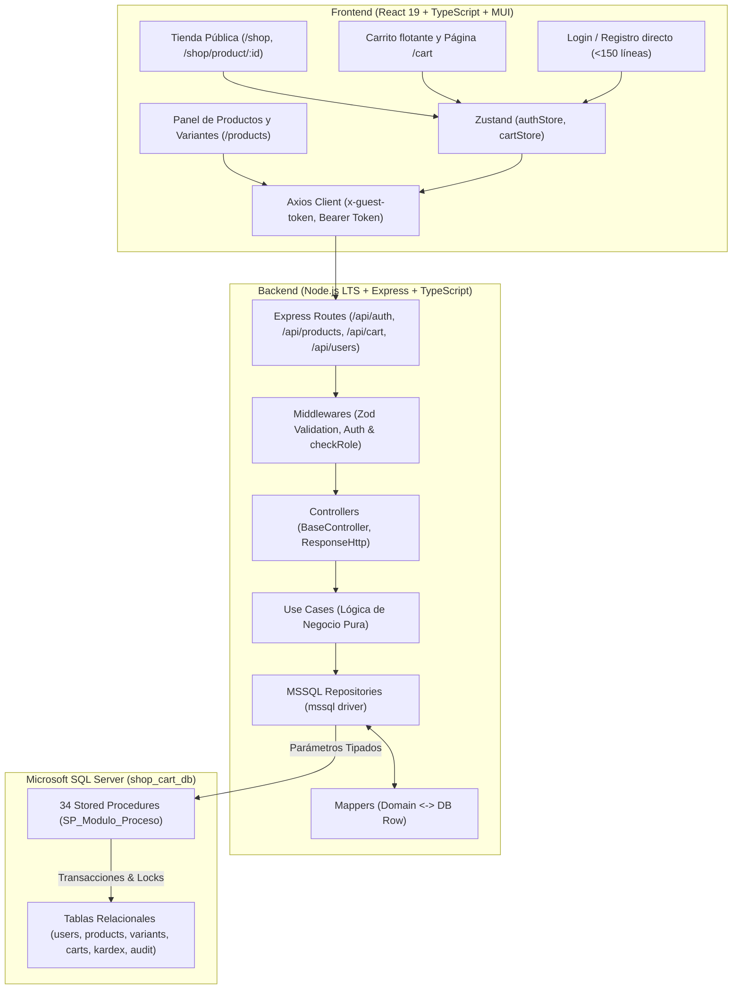

# shopCART — Plataforma de Comercio Electrónico y Gestión Comercial

Bienvenido a **shopCART**, una solución integral de comercio electrónico de alto rendimiento construida con arquitectura limpia (Clean Architecture / DDD), **Microsoft SQL Server (Transact-SQL)** mediante acceso exclusivo a datos vía **Stored Procedures**, y un frontend editorial responsivo en **React 19 + TypeScript + Vite + Material UI (MUI)** inspirado en la experiencia visual de **Ecom Marketplace**.

---

## Índice

1. [Requisitos del Entorno (Backend y Frontend)](#1-requisitos-del-entorno)
2. [Base de Datos Microsoft SQL Server](#2-base-de-datos-microsoft-sql-server)
   - [Ubicación de Scripts](#ubicación-de-scripts-sql)
   - [Scripts de Despliegue de Esquema y Stored Procedures](#scripts-de-despliegue)
   - [Ejecución de Seeds y Credenciales de Prueba](#ejecución-de-seeds-y-usuario-de-prueba)
3. [Arquitectura del Sistema](#3-arquitectura-del-sistema)
   - [Arquitectura en Backend (Clean Architecture / Hexagonal)](#arquitectura-en-backend)
   - [Arquitectura en Frontend (Modular en Capas)](#arquitectura-en-frontend)
   - [Diagrama de Arquitectura y Flujo de Datos](#diagrama-de-arquitectura)
4. [Tecnologías Utilizadas](#4-tecnologías-utilizadas)
5. [Catálogo Completo de Endpoints de la API](#5-catálogo-completo-de-endpoints-de-la-api)
   - [Módulo de Autenticación (`/api/auth`)](#módulo-de-autenticación-apiauth)
   - [Módulo de Usuarios (`/api/users`)](#módulo-de-usuarios-apiusers)
   - [Módulo de Productos, Variantes y Categorías (`/api/products`)](#módulo-de-productos-variantes-y-categorías-apiproducts)
   - [Módulo de Carrito de Compras (`/api/cart`)](#módulo-de-carrito-de-compras-apicart)
6. [Instrucciones de Instalación y Ejecución Local](#6-instrucciones-de-instalación-y-ejecución-local)

---

## 1. Requisitos del Entorno

### Requisitos Globales
- **Node.js**: `>= 20.x LTS` (Recomendado Node 22 o 24 LTS).
- **Gestor de paquetes**: `npm` `>= 10.x`.
- **Motor de Base de Datos**: **Microsoft SQL Server 2019+** (Local, Docker o Azure SQL Database) en el puerto `1433`.

### Variables de Entorno del Backend (`backend/.env`)
Crea el archivo `backend/.env` basándote en `backend/env.example`:
Crea el archivo `frontend/.env` basándote en `frontend/env.example`:
Las variables de entorno de los example son las mismas que se deben usar, solo copiarlas en el `.env` del backend y frontend

Las **OTP_PROVIDER** y **OTP_URL** son keys reales de un servicio externo llamado **send-otp** este servicio lo desplegue para esto en especifico: usarlo sin problemas.

```env
PORT=5600
FRONTEND_URL=http://localhost:5601

# Microsoft SQL Server (Transact-SQL)
DB_SERVER=localhost
DB_PORT=1433
DB_NAME=shop_cart_db
DB_USER=sa
DB_PASSWORD=TuPasswordSeguro123%
DB_ENCRYPT=true
DB_TRUST_SERVER_CERTIFICATE=true

# Seguridad JWT (jose)
JWT_SECRET=super_secret_jwt_key_shopcart_production_2026_xyz
JWT_ISS=shop-cart-backend
JWT_AUD=shop-cart-frontend
JWT_ACCESS_TTL=15m
JWT_REFRESH_TTL=7d

# Proveedores de Servicio (Email & OTP)
OTP_PROVIDER=auth_live_f55512036f70814ead9ad7a2311e3d7769330dd9333b1707
OTP_URL=https://send-otp-shopcart.onrender.com/api/v1/

# Seed Inicial
SEED_ADMIN_EMAIL=kevin01306@gmail.com
SEED_ADMIN_PASSWORD=12345678
```

### Variables de Entorno del Frontend (`frontend/.env`)
```env
VITE_API_URL=http://localhost:5600/api
```

---

## 2. Base de Datos Microsoft SQL Server

> [!IMPORTANT]
> **REQUISITO PREVIO INDISPENSABLE**:
> Antes de ejecutar `npm run db:init`, `npm run db:sp` o cualquier script de seed en el backend, la base de datos `shop_cart_db` **DEBE estar previamente creada** en tu instancia de Microsoft SQL Server (vía DBeaver, Azure Data Studio, SSMS o terminal):
> ```sql
> CREATE DATABASE shop_cart_db;
> ```
> Si la base de datos no existe físicamente en SQL Server, el driver rechazará la autenticación con el error `Login failed for user 'sa' (Reason: Failed to open the explicitly specified database 'shop_cart_db')`.

### Ubicación de Scripts SQL
Todos los scripts de base de datos se encuentran versionados en `backend/src/shared/db/scripts/`:
- **Esquema de Tablas y Restricciones**: `backend/src/shared/db/scripts/db.sql`
  - Tablas: `users`, `user_sessions`, `addresses`, `categories`, `products`, `product_variants`, `kardex_movements`, `carts`, `cart_items`, `stock_reservations`, `coupons`, `coupon_usages`, `orders`, `order_items`, `order_status_history`, `order_returns`, `audit_logs`.
- **Procedimientos Almacenados (SPs)**:
  - `backend/src/shared/db/scripts/SP/SP_Auth_Users.sql` (14 SPs de Auth y Usuarios)
  - `backend/src/shared/db/scripts/SP/SP_Products_Categories.sql` (13 SPs de Productos, Variantes, Categorías y Kardex)
  - `backend/src/shared/db/scripts/SP/SP_Carts.sql` (7 SPs de Carrito de Compras)

### Scripts de Despliegue
Para inicializar la base de datos sin necesidad de clientes externos, se crearon scripts dedicados ejecutables con npm desde la carpeta `backend/`:

1. **Creación del Esquema de Tablas (`db.sql`)**:
   ```bash
   cd backend
   npm run db:init
   ```
   *(Ejecuta `backend/src/shared/db/deploy-db.ts` creando todas las tablas con sus llaves foráneas y tipos estandarizados `DECIMAL(12,2)` e `INT`).*

2. **Despliegue y Actualización de Todos los Stored Procedures (`SP/*.sql`)**:
   ```bash
   cd backend
   npm run db:sp
   ```
   *(Ejecuta `backend/src/shared/db/deploy-sp.ts`, registrando de forma idempotente con `CREATE OR ALTER PROCEDURE` los 34 Stored Procedures en `shop_cart_db`).*

### Ejecución de Seeds y Usuario de Prueba

Para asegurar la existencia del usuario inicial con privilegios completos de administración, ejecuta:

```bash
cd backend
npm run db:seed
```

#### Credenciales del Usuario Administrador de Prueba:
- **Correo Electrónico**: `kevin01306@gmail.com`
- **Contraseña**: `12345678`
- **Rol en el Sistema**: `Administrador`
- **Estado**: Activo (`is_active = 1`) y Verificado (`is_verify = 1`).

> **Catálogo de Demostración (Opcional)**: Si deseas poblar la tienda con productos de ejemplo, variantes multiequipo y stock inicial en Kardex, ejecuta:
> ```bash
> npm run db:seed:catalog
> ```

---

## 3. Arquitectura del Sistema

### Arquitectura en Backend
El backend implementa **Clean Architecture (Arquitectura Limpia / Hexagonal)** dividida estrictamente en 4 capas desacopladas:
- **Domain Layer**: Entidades puras y contratos de repositorios (`interfaces`), sin dependencias de frameworks ni librerías de persistencia.
- **Application Layer**: Casos de uso (`UseCases`) que encapsulan la lógica de negocio pura, orquestación, reglas de validación y control de transacciones.
- **Infrastructure Layer**: Mapeadores (`Mappers`), proveedores externos (Argon2, JWT jose) y repositorios que implementan los contratos de dominio interactuando **exclusivamente mediante Stored Procedures con parámetros fuertemente tipados** usando el driver oficial `mssql`. **Cero ORMs ni concatenación de cadenas SQL**.
- **Presentation Layer**: Controladores Express, esquemas de validación con **Zod** y enrutadores con middlewares de autorización (`AuthMiddleware.checkRole`).

### Arquitectura en Frontend
El frontend en **React 19** sigue una estructura modular orientada a dominios:
- **`src/core/`**: Configuración de tema MUI (**Ecom Marketplace**), instancia tipada de Axios con interceptores de refresh token, utilidades de formato de moneda (`formatMoney` en Quetzales `GTQ` `Q`) y stores globales reactivos con **Zustand** (`authStore`, `cartStore`).
- **`src/modules/`**: Módulos independientes (`auth`, `shop`, `cart`, `products`, `profile`, `users`), cada uno con sus subcapas `domain/`, `infrastructure/` y `presentation/`.
- **Diseño Visual**: Estética limpia inspirada en **Ecom Marketplace**:
  - Color Primario: Azul Marino Pizarra `#425A8B` (títulos, precios principales y bordes).
  - Color de Acento: Naranja `#FD9636` (descuentos, estrellas, slider de precios y badges).
  - Bordes de tarjetas y contenedores: `#D5DFE4`.
  - Soporte de navegación pública para invitados (`invitado`) y clientes en la tienda (`/`, `/shop`, `/shop/product/:id`, `/cart`).
  - Panel administrativo protegido en `/products` para `Administrador` y `Operador`.

### Diagrama de Arquitectura



---

## 4. Tecnologías Utilizadas

| Capa | Tecnología | Propósito |
| :--- | :--- | :--- |
| **Backend** | **Node.js 24 LTS** | Entorno de ejecución en modo módulos ESM (`"type": "module"`). |
| **Backend** | **TypeScript 5.9** | Tipado estricto en tiempo de compilación sin `any` innecesarios. |
| **Backend** | **Express 5** | Servidor HTTP y enrutamiento modular. |
| **Backend** | **mssql (Tedious)** | Driver oficial nativo para Microsoft SQL Server sin ORM. |
| **Backend** | **Zod 4** | Validación de payloads en body, query params y parámetros de ruta. |
| **Backend** | **Argon2** | Hashing criptográfico unidireccional de contraseñas. |
| **Backend** | **jose** | Generación, firma y validación de tokens JWT (`access`, `refresh`). |
| **Frontend** | **React 19** | Biblioteca para interfaces de usuario reactivas y componentes funcionales. |
| **Frontend** | **Vite 8** | Empaquetador ultrarrápido para desarrollo y compilación de producción. |
| **Frontend** | **Material UI (MUI) 7** | Sistema de diseño de componentes adaptado al theme **Ecom Marketplace**. |
| **Frontend** | **Zustand** | Gestión de estado global ligera para sesión y carrito de compras. |
| **Frontend** | **React Hook Form + Zod** | Formularios optimizados con validación de esquemas en tiempo real. |
| **Base de Datos** | **Microsoft SQL Server** | Base de datos relacional con integridad referencial y procedimientos `SP_`. |

---

## 5. Catálogo Completo de Endpoints de la API

### Módulo de Autenticación (`/api/auth`)
| Método | Ruta | Acceso | Descripción |
| :--- | :--- | :--- | :--- |
| `POST` | `/api/auth/register` | Público | Registro inmediato de cliente (`Cliente`) sin OTP obligatorio con logueo instantáneo. |
| `POST` | `/api/auth/login` | Público | Inicio de sesión con correo y contraseña. Emite `accessToken` y cookie `refreshToken`. |
| `POST` | `/api/auth/refresh` | Público (Cookie) | Rotación de sesión y emisión de un nuevo `accessToken`. |
| `POST` | `/api/auth/logout` | Autenticado | Cierre de sesión, eliminación de sesión en base de datos y borrado de cookie. |
| `GET` | `/api/auth/me` | Autenticado | Obtiene el perfil del usuario autenticado. |

### Módulo de Usuarios (`/api/users`)
| Método | Ruta | Acceso | Descripción |
| :--- | :--- | :--- | :--- |
| `GET` | `/api/users/roles` | `Administrador` | Lista los 3 roles del sistema (`Administrador`, `Operador`, `Cliente`). |
| `PATCH` | `/api/users/me/password` | Autenticado | Permite al usuario en sesión actualizar su propia contraseña. |
| `GET` | `/api/users` | `Administrador` | Listado paginado de usuarios con búsqueda por nombre o correo. |
| `POST` | `/api/users` | `Administrador` | Creación administrativa de usuario y envío de bienvenida. |
| `PUT` | `/api/users/:id` | `Administrador` | Modificación de datos y rol de usuario. |
| `PATCH` | `/api/users/:id/activate` | `Administrador` | Reactivación lógica de usuario (`is_active = 1`). |
| `PATCH` | `/api/users/:id/disable` | `Administrador` | Desactivación lógica de usuario (`is_active = 0`). |
| `DELETE` | `/api/users/:id` | `Administrador` | Borrado lógico de usuario (`is_active = 0`). |

### Módulo de Productos, Variantes y Categorías (`/api/products`)
| Método | Ruta | Acceso | Descripción |
| :--- | :--- | :--- | :--- |
| `GET` | `/api/products/catalog` | Público | Catálogo con filtros de categoría, precio, búsqueda y ordenamiento. |
| `GET` | `/api/products/catalog/categories` | Público | Categorías activas con conteo de productos para los filtros. |
| `GET` | `/api/products/catalog/:id` | Público | Detalle de producto con todas sus variantes activas. |
| `GET` | `/api/products/categories` | `Admin`, `Operador` | Lista todas las categorías para administración. |
| `POST` | `/api/products/categories` | `Admin`, `Operador` | Crea una nueva categoría. |
| `PUT` | `/api/products/categories/:id` | `Admin`, `Operador` | Actualiza nombre o estado de una categoría. |
| `GET` | `/api/products` | `Admin`, `Operador` | Listado administrativo de productos con variantes y stock. |
| `GET` | `/api/products/:id` | `Admin`, `Operador` | Detalle administrativo de producto con variantes. |
| `POST` | `/api/products` | `Admin`, `Operador` | Crea producto junto con su arreglo inicial de variantes y Kardex. |
| `PUT` | `/api/products/:id` | `Admin`, `Operador` | Actualiza producto y sincroniza/modifica variantes. |
| `PATCH` | `/api/products/:id/status` | `Admin`, `Operador` | Activa o desactiva lógicamente un producto. |
| `POST` | `/api/products/:id/variants` | `Admin`, `Operador` | Agrega una variante a un producto existente con entrada a Kardex. |
| `PUT` | `/api/products/:id/variants/:variantId` | `Admin`, `Operador` | Actualiza atributos, precio o estado de una variante. |
| `PATCH` | `/api/products/:id/variants/:variantId/stock` | `Admin`, `Operador` | Ajuste transaccional de stock (`ENTRADA`, `SALIDA`, `AJUSTE`) con Kardex. |

### Módulo de Carrito de Compras (`/api/cart`)
| Método | Ruta | Acceso | Descripción |
| :--- | :--- | :--- | :--- |
| `GET` | `/api/cart` | Público / `x-guest-token` / Bearer | Consulta el carrito activo, ítems y subtotales en GTQ. |
| `POST` | `/api/cart/items` | Público / `x-guest-token` / Bearer | Agrega o incrementa un producto/variante en el carrito. |
| `PUT` | `/api/cart/items/:variantId` | Público / `x-guest-token` / Bearer | Actualiza la cantidad exacta de una variante. |
| `DELETE` | `/api/cart/items/:variantId` | Público / `x-guest-token` / Bearer | Elimina una variante del carrito. |
| `DELETE` | `/api/cart` | Público / `x-guest-token` / Bearer | Vacía todos los ítems del carrito. |
| `POST` | `/api/cart/sync` | Autenticado | Fusiona los ítems del carrito de invitado al iniciar sesión. |

---

## 6. Instrucciones de Instalación y Ejecución Local

### Paso 1: Clonar el repositorio
```bash
git clone <URL_DEL_REPOSITORIO>
cd shop-cart
```

### Paso 2: Configurar y ejecutar el Backend
```bash
cd backend

# Instalar dependencias
npm install

# Configurar variables de entorno
cp .env.example .env

# [IMPORTANTE] Asegúrate de que la base de datos exista en tu SQL Server:
# CREATE DATABASE shop_cart_db;

# Crear tablas y desplegar Stored Procedures en SQL Server
npm run db:init
npm run db:sp

# Sembrar usuario Administrador inicial
npm run db:seed

# (Opcional) Sembrar catálogo de demostración
npm run db:seed:catalog

# Ejecutar pruebas automatizadas (30 tests)
npm test

# Iniciar backend en modo desarrollo (puerto 4000)
npm run dev
```

### Paso 3: Configurar y ejecutar el Frontend
```bash
cd ../frontend

# Instalar dependencias
npm install

# Iniciar servidor de desarrollo (puerto 8001 / 5173)
npm run dev
```

Abre tu navegador en `http://localhost:8001` (o la URL indicada por Vite) para interactuar con la plataforma **shopCART**.
